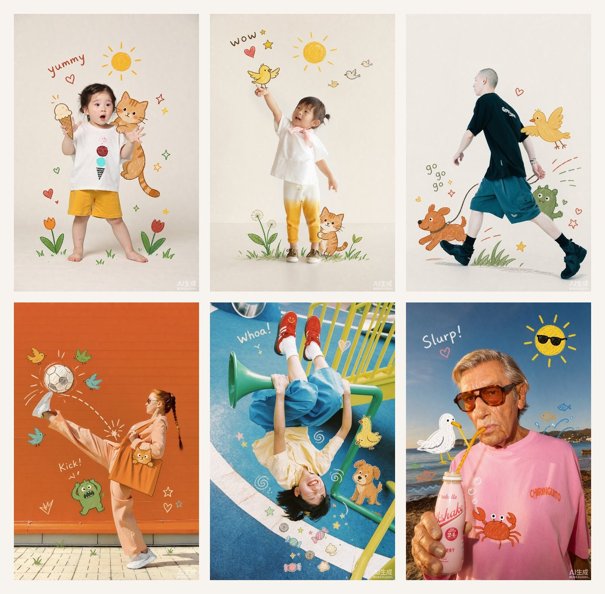
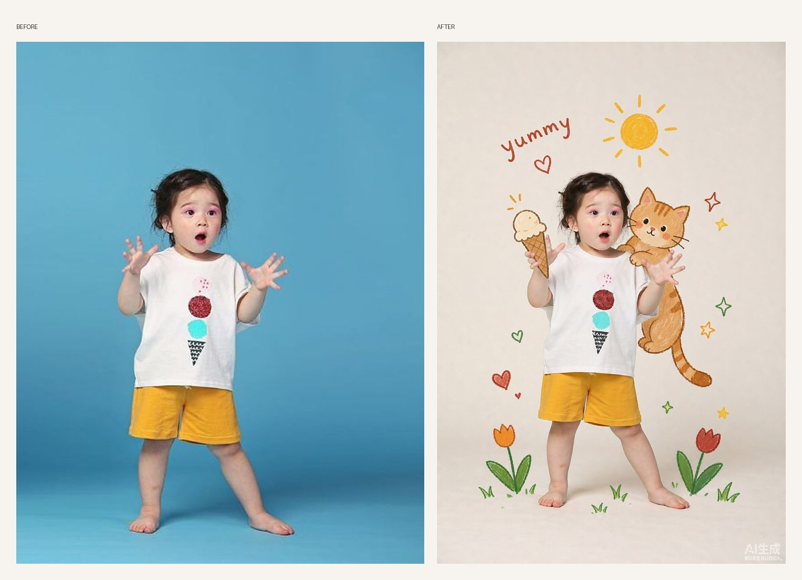
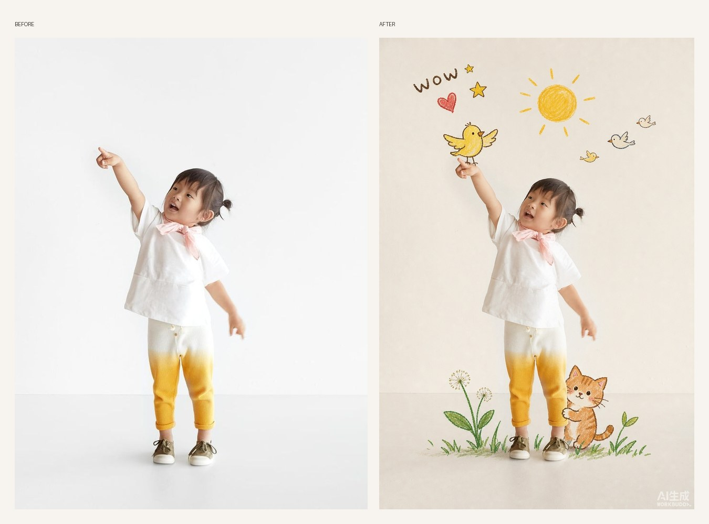
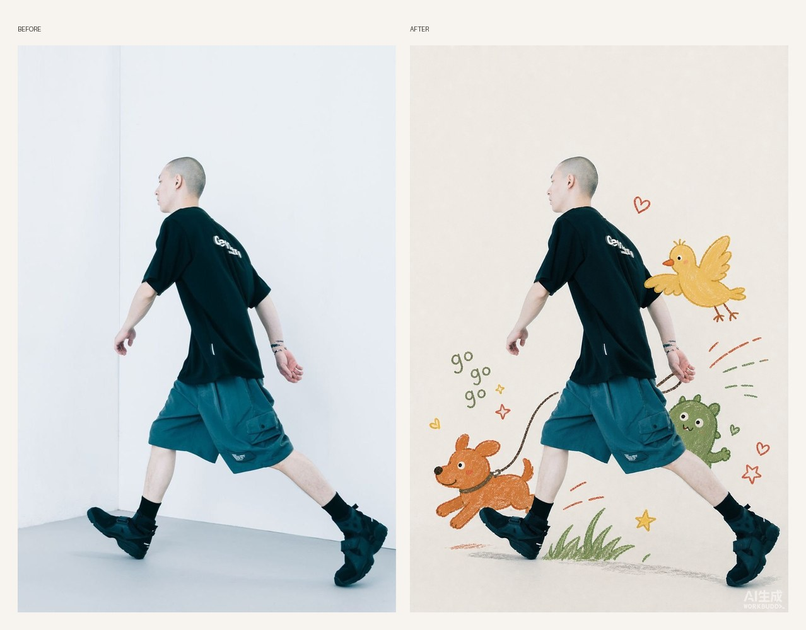
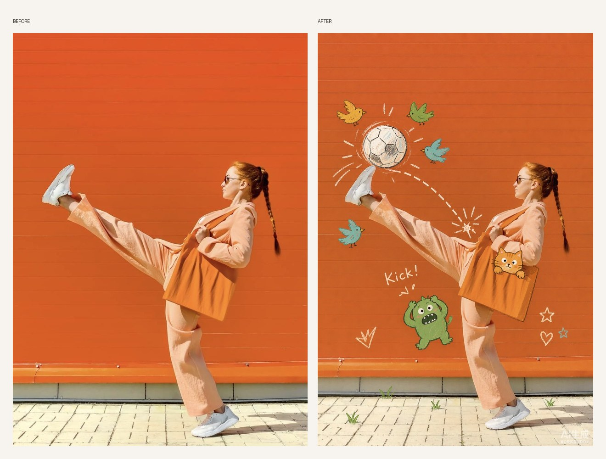

# Child Photo Doodle Collage

Turn a supplied photograph into a studio creative portrait where a real child and flat crayon doodles live in one picture — the drawings **hold hands, sit on shoulders, grip clothing, and grow from bare feet** instead of floating around as stickers.



## What it does

The skill keeps the subject's face, expression, pose, hairstyle, and clothing recognizable, moves them onto a clean off-white studio backdrop, and builds a crayon-doodle ecosystem that physically interacts with the body:

- **held** — a doodle ice cream cone gripped by an open hand
- **shoulder-rider** — a doodle kitten perched on the shoulder, paws gripping the shirt
- **ground-grow** — hand-drawn grass and tulips sprouting beside the shoes
- **finger-touch** — a bird landing exactly on a pointing fingertip
- **peek** — a small creature looking out from behind the body
- **leash-walk** — a doodle dog trotting in step, the leash in the subject's real hand

Every result also gets one small hand-written English word (`yummy`, `cute`, `Happy day`), plus tiny hearts and stars.

### Children



### Poses with a built-in interaction



### Action and movement



### Scene-keep variant

When the outfit and background are deliberately color-matched (an orange suit against an orange wall, a red ball in a turquoise sky), the skill keeps the real scene instead of replacing it, and switches the doodle palette to high-contrast cream, green, and sky blue.



## Install

Ask your agent to install the skill from GitHub:

```text
Install the skill from https://github.com/haomiaomou-cmd/child-photo-doodle-collage/tree/main/skill/child-photo-doodle-collage
```

Or copy the skill folder manually into your skills directory:

```bash
# user-level (available in every project)
cp -r skill/child-photo-doodle-collage ~/.workbuddy/skills/

# project-level (shared with the repository)
cp -r skill/child-photo-doodle-collage <project>/.workbuddy/skills/
```

The skill becomes available on the next turn after installation.

## Use

Attach a photograph and invoke:

```text
$child-photo-doodle-collage
```

or simply:

```text
帮我把这张照片做成儿童涂鸦写真
```

The skill inspects the photo, finds the interaction anchors (empty hands, bare feet, held props, mid-air pose), picks a doodle theme that echoes the clothing print, states the image-generation cost, and generates one finished image. Then it asks what to adjust.

## Iteration

Ask in plain language and the skill regenerates from the **original** photo with only the requested part changed:

```text
小猫直接趴在肩膀上
把它换成一顶手绘帽子
让互动再强一点，她咬一口冰淇淋
```

## Layout

```text
skill/child-photo-doodle-collage/
├── SKILL.md                    # workflow, style contract, interaction presets, validation policy
├── references/
│   ├── style-system.md         # analysis of the five reference images, palette, element vocabulary
│   └── prompt-recipes.md       # copy-ready generation prompts and correction briefs
└── assets/
    ├── style-ref-01..05.jpg    # authoritative style references
    ├── input-photo-example.png # verified input
    └── standard-output.png     # verified output
```

## How the style works

1. Real photo as the base, identity untouched.
2. Clean studio backdrop with generous negative space.
3. Flat crayon marks only — solid color blocks, wobbly outlines, naive proportions.
4. Contact beats decoration: at least two doodles must touch, occlude, or be gripped by the body.
5. A warm limited palette: orange, mustard, grass green, brick red, cream.

See [`references/style-system.md`](skill/child-photo-doodle-collage/references/style-system.md) for the full breakdown.

## License

MIT
